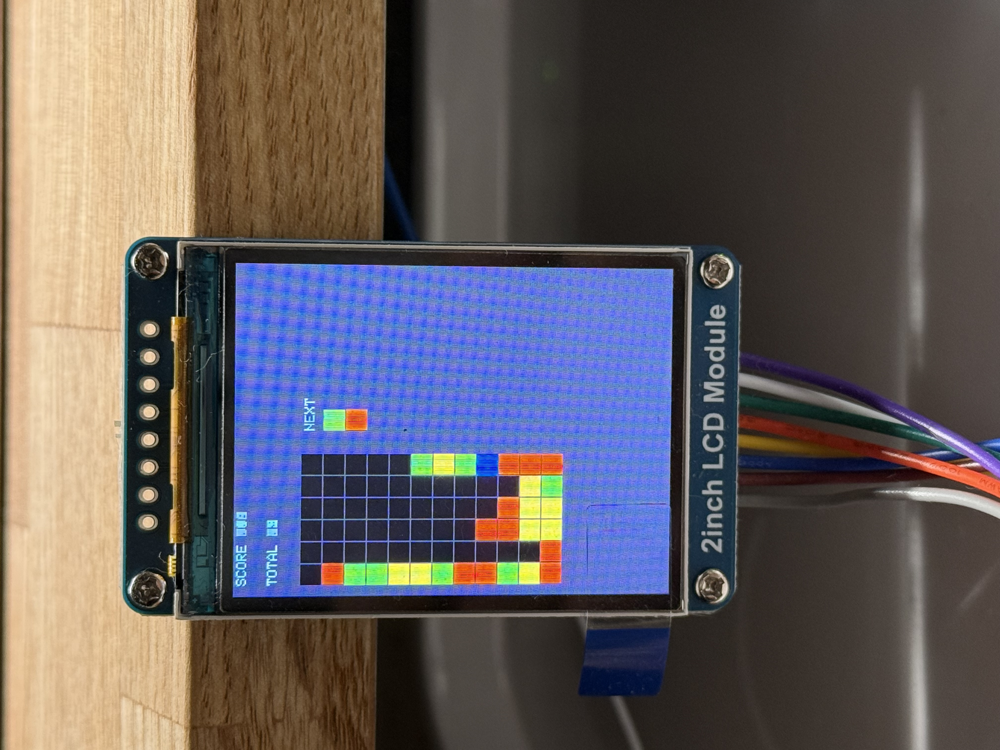
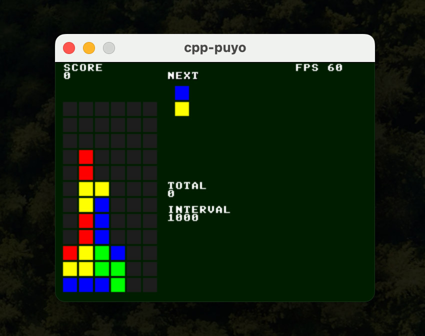
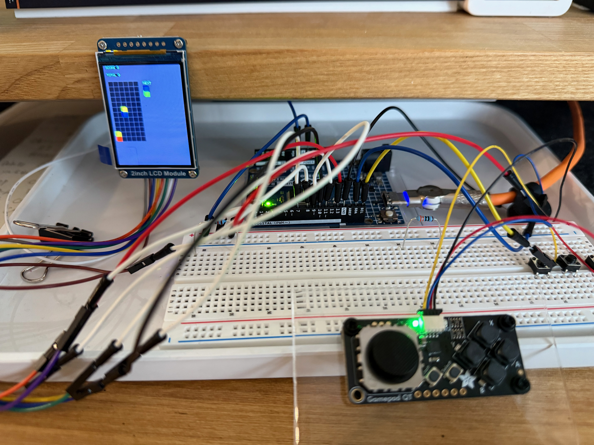
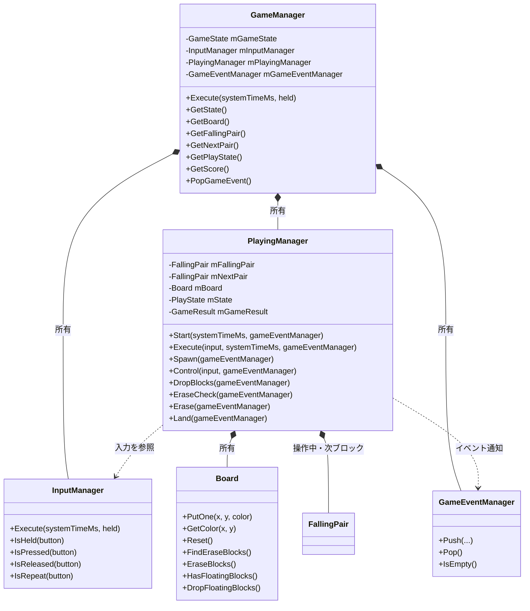
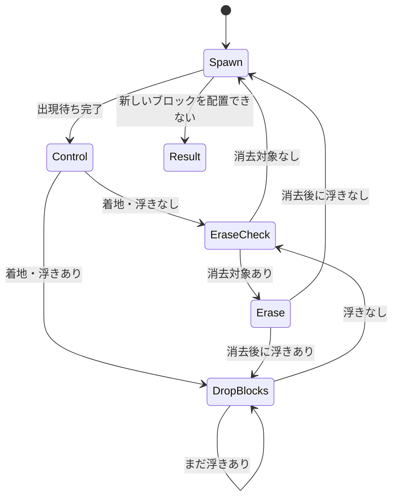

# cpp-puyo

落ちものパズルを題材にした C++17 のポートフォリオ作品です。  
同じゲームロジック（`core`）を、**macOS上のPC版（SDL2）** と **Arduino UNO R4 Minima実機（ST7789 LCD）** の両方で動かしています。

### Arduino実機 動作動画

[](https://github.com/user-attachments/assets/c85976d3-4cd8-4e53-8478-02fcb9a4c923)

[▶ 動画を再生する（約27秒）](https://github.com/user-attachments/assets/c85976d3-4cd8-4e53-8478-02fcb9a4c923)

### PC版



### Arduino UNO R4 Minima版





## 概要

ゲームロジックをプラットフォーム非依存の `core` として分離し、PC版とArduino版で同じソースを共有しています。

組み込み開発を意識し、メモリ使用量、固定長データ構造、LCD描画負荷、入力処理、時間管理、自動テストまで含めて設計しています。

## 制作目的

長年の C/C++ ゲーム開発経験を、組み込み・産業系ソフトウェア開発でも活用できる形で示すことを目的に制作しています。

特に以下を重視しています。

- PC / Arduinoで共通利用できるゲームロジック設計
- プラットフォーム依存処理と `core` の分離
- Arduinoのメモリ制約を意識したデータ構造
- LCD・ゲームパッドなど実機I/Oの利用
- CMake / CTestによるビルド・自動テスト
- 状態遷移とPauseを含む時間管理

同じロジックを異なる実行環境で動かすことで、移植性・保守性を意識した設計を実践しています。

## 見どころ

| 観点 | 実装内容 |
|---|---|
| PC / Arduino共通core | ゲーム進行、盤面、入力、消去、連鎖などを `core` に集約し、描画や実機I/Oだけを分離 |
| 組み込み向け省メモリ設計 | 固定長データ構造を優先し、ゲームイベントを16bitへパック |
| Arduino LCDの差分描画 | 前回表示との差分だけを更新し、SPI通信量と描画負荷を低減 |
| 入力処理の共通化 | `InputManager` が `Held / Pressed / Released / Repeat` を生成 |
| Pauseを考慮した時間管理 | Pause中の実時間を各タイマーから除外し、再開時の処理飛びを防止 |
| PC上での自動テスト | `Board`、`InputManager`、`GameEvent` などをCTestで検証 |

---

## システム構成

ゲームロジックとプラットフォーム依存処理を分離しています。

<details>
<summary>構成図を表示</summary>

```text
                +----------------------+
                |        core          |
                |----------------------|
                | Board                |
                | GameManager          |
                | PlayingManager       |
                | InputManager         |
                | FallingPair          |
                | GameEvent            |
                +----------+-----------+
                           |
             +-------------+-------------+
             |                           |
             v                           v
+------------------------+   +----------------------------+
|     platform_pc        |   |     platform_arduino       |
|------------------------|   |----------------------------|
| SDL2                   |   | ST7789 LCD                 |
| キーボード入力         |   | seesawゲームパッド        |
| PC向け描画・演出       |   | Arduino向け描画・入力    |
+------------------------+   +----------------------------+
             |                           |
             v                           v
          macOS                    Arduino UNO R4 Minima
```

</details>

### `core`

PC版とArduino版で共通利用する、プラットフォーム非依存のゲームロジックです。

主に以下を担当します。

- 盤面管理
- 落下中ブロックの管理
- 移動・回転・落下
- 接地処理
- 消去判定
- 連鎖処理
- スコア計算
- 入力状態管理
- ゲームイベント通知
- Pauseを含むゲーム内時間管理

`core` 内ではSDL2やArduino固有APIを使用しません。

### `platform_pc`

macOS上で動作するPC版固有の処理です。

- SDL2による描画
- キーボード入力
- 消去・連鎖エフェクト
- Pause表示
- PC向けメインループ

### `platform_arduino`

Arduino UNO R4 Minima向けの処理です。

- ST7789 LCDへの描画
- seesawゲームパッドからの入力
- Arduino向けメインループ
- LCDの差分描画
- Pause操作・表示
- NEXT / SCORE / TOTALの不要な再描画削減

---

## 使用技術

依存関係のバージョンは固定せず、確認できている一般名称で記載しています。

| 区分 | 内容 |
|---|---|
| 言語 | C++17 |
| ビルド・テスト | CMake / CTest |
| PC版 | macOS / Clang / SDL2 |
| Arduino版 | Arduino UNO R4 Minima / Arduino IDE |
| Arduinoライブラリ | Adafruit GFX Library / Adafruit ST7735 and ST7789 Library / Adafruit seesaw Library |
| LCD通信 | SPI |
| ゲームパッド通信 | I2C |
| 単体テスト | CTest / `assert` |

### 動作確認環境

#### macOS

- PC版のビルド・実行
- Arduino UNO R4 Minimaへの書き込み
- Arduino実機での動作確認

#### Windows

- PC版のビルド確認
- Arduino UNO R4 Minima向けVerify
- CTestによる自動テスト

---

## ディレクトリ構成

<details>
<summary>ディレクトリツリーを表示</summary>

```text
cpp-puyo/
├─ core/
│  ├─ Board.cpp
│  ├─ Board.h
│  ├─ FallingPair.h
│  ├─ GameConfig.h
│  ├─ GameEvent.h
│  ├─ GameManager.cpp
│  ├─ GameManager.h
│  ├─ GameTypes.h
│  ├─ InputManager.cpp
│  ├─ InputManager.h
│  ├─ PlayingManager.cpp
│  └─ PlayingManager.h
│
├─ platform_pc/
│  ├─ main.cpp
│  ├─ Renderer.*
│  ├─ Effect.*
│  ├─ PcConfig.*
│  └─ font8x8.*
│
├─ platform_arduino/
│  └─ cpp_puyo_arduino/
│     ├─ cpp_puyo_arduino.ino
│     ├─ InputState.h
│     ├─ ArduinoRenderer.h
│     └─ ArduinoRenderer.cpp
│
├─ tests/
│  ├─ test_board.cpp
│  ├─ test_game_event.cpp
│  ├─ test_input.cpp
│  └─ test_playing_manager.cpp
│
└─ CMakeLists.txt
```

</details>

### 主なクラス

| クラス | 主な役割 |
|---|---|
| `GameManager` | ゲーム全体の状態管理 |
| `PlayingManager` | プレイ中の状態遷移・ゲーム進行 |
| `Board` | 盤面、配置、消去判定、落下処理 |
| `FallingPair` | 操作中の2個1組のブロック |
| `InputManager` | Held / Pressed / Released / Repeat の生成 |
| `GameEventManager` | ゲームイベントを固定長リングバッファで保持・管理 |
| `GameEvent` | coreからプラットフォーム側へのイベント通知 |

### クラス図

主要クラス間の所有関係と依存関係を簡略化して示します。  
すべてのメンバや関数を列挙するのではなく、設計上の責務と関係が分かる範囲に絞っています。



`*--` はメンバとして保持する所有関係、`..>` は引数などを通して利用する依存関係を表しています。

### ゲーム状態遷移図

`PlayingManager` の `PlayState` の遷移を示します。Pauseは独立したフラグで管理し、現在の `PlayState` を維持したままゲーム進行を停止するため、この図には状態として含めていません。



---

## 実装上の工夫

### 1. PC版とArduino版でゲームロジックを共通化

PC版とArduino版でゲームルールを別々に実装すると、同じ処理を二重管理することになり、修正漏れや動作差異が発生しやすくなります。

そこで、

- ゲームルール
- 盤面
- 入力状態
- 状態遷移
- スコア
- イベント

などを `core` に集約しました。

PC版とArduino版では、描画やデバイス入力などのプラットフォーム依存部分だけを個別に実装しています。

これにより、ゲームロジックの修正箇所を一か所に集約し、PC上で確認したロジックをArduinoでもそのまま利用できます。

---

### 2. ゲームイベントを16bitにパック

ArduinoのRAM使用量を抑えるため、ゲーム中に発生するイベント情報を16bitにパックしています。

```text
bit:  FEDCBA9876543210
      EEEXXXYYYYVVVVVV

E : GameEventType  3bit
X : X座標          3bit
Y : Y座標          4bit
V : value          6bit
```

`value` の意味はイベント種別によって変わります。

- `BlockErased` : ブロック色
- `Chain` : 連鎖数
- `GameOver` : 未使用

マスクとビットシフトを使って値を設定・取得します。

1イベントを2byteにすることで、固定長イベントキューのRAM使用量を抑えています。

---

### 3. Arduino LCDを差分描画

Arduino版では、毎フレーム盤面全体を再描画していません。

まず、

1. 固定済みの `Board` をコピー
2. その上に操作中の `FallingPair` を重ねる
3. 最終的に表示したい盤面を作る
4. 前回表示した盤面と比較する
5. 変化したマスだけLCDへ描画する

という流れで更新しています。

これにより、

- 移動
- 回転
- 接地
- 消去

を個別の描画処理として扱う必要が減り、同じ差分更新の仕組みで処理できます。

また、SPI通信量とLCD描画負荷の削減にもつながります。

盤面だけでなく、NEXT / SCORE / TOTALについても表示内容が変化した場合だけ更新し、不要な再描画を抑えています。

---

### 4. 入力処理をPC / Arduinoで共通化

PCのキーボードとArduinoのゲームパッドでは、入力を取得する方法が異なります。

プラットフォーム側では「現在押されているボタン」のビット状態だけを `core` へ渡します。

`InputManager` が前回状態と比較し、

- `Held` : 押されている
- `Pressed` : 押した瞬間
- `Released` : 離した瞬間
- `Repeat` : 長押しリピート

を生成します。

これにより、入力デバイスが変わってもゲーム側の操作ロジックを共通化できます。

---

### 5. Pause中はゲーム処理だけでなくゲーム内時間も停止

ゲーム進行には複数のタイマーがあります。

- 自動落下
- 新しいブロックの出現待ち
- 浮遊ブロックの落下
- 消去判定待ち
- 消去演出

単純にPause中の処理を `return` するだけでは、実時間は進み続けます。

例えば消去処理の途中で数秒Pauseすると、再開した瞬間に消去待ち時間がすでに経過したものとして扱われてしまいます。

そのため、

1. Pause開始時刻を保存
2. Pause解除時にPauseしていた時間を算出
3. 各処理の開始時刻へPause時間を加算

することで、Pause中の時間をゲーム進行時間から除外しています。

これにより、Pause前の残り時間を維持したまま自然にゲームを再開できます。

PC版の描画エフェクトもPauseに対応し、途中の進行状態を維持したまま停止・再開します。

時刻は32bitのミリ秒値で保持し、絶対時刻の大小ではなく「現在時刻 - 開始時刻」の差分で経過時間を判定しています。

これにより、タイマのオーバーフローを考慮した時間判定にしています。

---

### 6. 固定長データ構造を優先

Arduinoでの動作を考慮し、最大サイズをあらかじめ決められるデータには固定長データ構造を使用しています。

例：

- 盤面
- 消去フラグ
- ゲームイベントキュー
- 入力状態

必要以上の動的メモリ確保を避け、RAM使用量を予測しやすい構成を目指しています。

---

## メモリ使用量（Arduino UNO R4 Minima）

Arduino IDEの最新のVerify結果と、固定長イベントキューの設計値は以下のとおりです。

| 項目 | 値 | 備考 |
|---|---:|---|
| Flash使用量 | 73,392 bytes（27%） | 最大262,144 bytes |
| グローバル変数（RAM） | 6,380 bytes（19%） | 最大32,768 bytes |
| 利用可能RAM | 26,388 bytes | ローカル変数などに利用可能 |
| `GameEvent` | 2 bytes / event | 16bitにパック |
| イベントキュー | 148 bytes | 2 bytes × 74 slots |
| キューの実効容量 | 73 events | 空状態と満杯状態を区別するため1スロットを空ける方式 |

イベントキューは固定長のリングバッファとして実装しています。盤面全体72セルが消去対象になった場合の `BlockErased` 最大72件と、`Chain` イベント1件を保持できるよう、74スロット中73イベントを使用可能としています。

### 型サイズ最適化の実測結果（過去の比較）

`enum class BlockColor` などの基底型を `std::uint8_t` に指定した際に、変更前後を同じ方法で測定した結果です。以下は当時の比較値であり、上記の最新Verify結果とは測定時点が異なります。

| 項目 | 変更前 | 変更後 | 差分 |
|---|---:|---:|---:|
| `sizeof(Board)` | 312 bytes | 96 bytes | **216 bytes削減（約69%）** |
| Flash使用量 | 73,828 bytes | 73,876 bytes | 48 bytes増加 |
| グローバル変数（RAM） | 6,800 bytes | 6,360 bytes | **440 bytes削減** |
| 利用可能RAM | 25,968 bytes | 26,408 bytes | **440 bytes増加** |

`Board` 単体では216 bytes、ビルド全体のグローバルRAMでは440 bytes削減できました。Flash使用量は48 bytes増えているため、RAM削減とFlash増加の両方を実測値として記録しています。

---

## 自動テスト

ゲームロジックを `core` として分離しているため、Arduino実機を使わずPC上でロジックをテストできます。

CMake / CTestを利用し、現在は主に以下を確認しています。

### `Board`

- 指定位置へのブロック配置と取得
- `Reset()`
- 同色3個では消えない
- 同色4個で消える
- 5個以上の場合もすべて消去対象になる
- 横方向・縦方向の連結
- L字・T字の連結
- 同じ色でも離れている場合は別グループとして扱う
- `EraseBlocks()`
- 浮遊ブロック検出
- 1段ずつの落下
- 下にブロックがある場合、その直上で停止する

### `InputManager`

- Held
- Pressed
- Released
- Repeat
- 初回Repeatまでの待ち時間
- 2回目以降のRepeat間隔
- ボタンを離して再度入力した場合の状態

### `GameEvent` / `GameEventManager`

- イベント種別
- X座標
- Y座標
- value
- 16bitパック後の値の復元
- イベントキューへのPush / Pop
- 実効容量73件までPushできること
- 満杯時に74件目のPushを拒否すること
- リングバッファのwrap-around後もFIFO順を維持すること

### `PlayingManager`

- Pause中の経過時間が自動落下に加算されないこと
- Pause前の自動落下までの残り時間がResume後にも保持されること
- `Spawn -> Control`
- `Control -> EraseCheck`
- `Control -> DropBlocks`

### テスト実行

Windowsの例：

```powershell
cmake --build build-win
ctest --test-dir build-win -C Debug --output-on-failure
```

成功時：

```text
100% tests passed, 0 tests failed
```

ゲーム画面を操作して確認するだけではなく、内部実装を変更した際に既存動作を壊していないことを自動テストで確認できるようにしています。

特に今後、盤面の内部表現やメモリ使用方法を変更する場合にも、外部から見た動作が維持されていることを確認するために利用します。

---

## PC版のビルド・実行

### 必要なもの

- macOS
- CMake
- C++17対応コンパイラ
- SDL2

### リポジトリ取得

```bash
git clone https://github.com/Numa-alt/cpp-puyo.git
cd cpp-puyo
```

### ビルド

```bash
cmake -S . -B build
cmake --build build
```

生成された `cpp_puyo` を実行します。

```bash
./build/cpp_puyo
```

環境やCMakeジェネレータによって、実行ファイルの出力先が異なる場合があります。

PC版では `core` を独立したライブラリとしてビルドし、`platform_pc` からリンクしています。

---

## ハードウェア構成

| 部品 | 型番・仕様 | 接続 |
|---|---|---|
| マイコンボード | Arduino UNO R4 Minima | - |
| LCD | Waveshare 2インチ IPS LCD / 240×320 / ST7789V/VW | SPI |
| ゲームパッド | STEMMA QT / Qwiic互換 seesaw ミニ I2Cゲームパッド | I2C / `0x50` |
| 接続ケーブル | STEMMA QT / Qwiic JST SH 4ピン - ピンソケット変換ケーブル 150mm | I2C接続 |

### 配線

#### LCD

Waveshare 2インチ IPS LCD（240×320 / ST7789V/VW）をSPIで接続しています。

| LCD信号 | Arduino UNO R4 Minima |
|---|---|
| VCC | 5V |
| GND | GND |
| DIN / MOSI | D11 |
| CLK / SCK | D13 |
| CS | D10 |
| DC | D7 |
| RST | D8 |
| BL | D9 |

描画には `Adafruit_ST7789` を使用しています。

#### ゲームパッド

STEMMA QT / Qwiic互換のseesawミニI2Cゲームパッドを接続しています。

| ゲームパッド信号 | Arduino UNO R4 Minima |
|---|---|
| VCC | 5V |
| GND | GND |
| SDA | SDA |
| SCL | SCL |

I2Cアドレスは `0x50` です。

#### 配線図

```text
Arduino UNO R4 Minima
│
├─ 5V  ─────────────── LCD VCC
├─ GND ─────────────── LCD GND
├─ D11 (MOSI) ──────── LCD DIN
├─ D13 (SCK) ───────── LCD CLK
├─ D10 ─────────────── LCD CS
├─ D7  ─────────────── LCD DC
├─ D8  ─────────────── LCD RST
├─ D9  ─────────────── LCD BL
│
├─ 5V  ─────────────── Gamepad VCC
├─ GND ─────────────── Gamepad GND
├─ SDA ─────────────── Gamepad SDA
└─ SCL ─────────────── Gamepad SCL
```

---

## Arduino版のビルド

### 必要なもの

- Arduino UNO R4 Minima
- Arduino IDE
- Waveshare 2インチ IPS LCD（240×320、ST7789V/VW）
- STEMMA QT / Qwiic互換 seesaw ミニ I2Cゲームパッド
- STEMMA QT / Qwiic JST SH 4ピン - ピンソケット変換ケーブル 150mm

### Arduinoライブラリ

Arduino IDEのLibrary Managerから以下をインストールします。

- Adafruit GFX Library
- Adafruit ST7735 and ST7789 Library
- Adafruit seesaw Library

UNO R4用ボードパッケージとして、

```text
Arduino UNO R4 Boards
```

もインストールします。

### ボード設定

Arduino IDEで、

```text
Tools
→ Board
→ Arduino UNO R4 Boards
→ Arduino UNO R4 Minima
```

を選択します。

---

### `PuyoCore` の設定

Arduino版からもリポジトリ内の `core` を直接利用します。

Arduino Sketchbook内に以下を用意します。

```text
<Sketchbook location>/
└─ libraries/
   └─ PuyoCore/
      ├─ library.properties
      └─ src/
```

`library.properties`：

```text
name=PuyoCore
version=1.0.0
author=Numashita
maintainer=Numashita
sentence=Platform independent core for cpp-puyo
paragraph=Shared game logic for PC and Arduino.
category=Other
architectures=*
```

`src` はリポジトリ内の、

```text
cpp-puyo/core
```

を参照するようにします。

これにより、PC版とArduino版で `core` のソースをコピーせず、同じコードを利用できます。

#### macOS

シンボリックリンクを利用できます。

```bash
ln -s /path/to/cpp-puyo/core \
      ~/Documents/Arduino/libraries/PuyoCore/src
```

Sketchbook locationが異なる場合は、その場所に合わせて変更します。

#### Windows

ジャンクションを利用できます。

```powershell
cmd /c mklink /J src C:\path\to\cpp-puyo\core
```

このコマンドは、

```text
<Sketchbook location>\libraries\PuyoCore
```

で実行します。

---

### スケッチ

Arduino IDEで以下を開きます。

```text
platform_arduino/cpp_puyo_arduino/cpp_puyo_arduino.ino
```

UNO R4 Minimaを選択して `Verify` を実行します。

実機へ書き込む場合は、UNO R4 Minimaのポートを選択して `Upload` を実行します。

---

## 現在の動作確認

### PC版

- タイトル画面
- ブロック移動
- 回転
- 自動落下
- 接地
- 消去
- 連鎖
- スコア
- NEXT表示
- 消去数表示
- Game Over
- Pause
- 消去・連鎖エフェクト

### Arduino版

- Arduino向けソース整理
- ST7789 LCD表示
- ゲームパッド入力
- 移動
- 回転
- 自動落下
- 接地
- 消去
- 連鎖
- NEXT表示
- SCORE表示
- TOTAL表示
- Pause操作・表示
- LCD差分描画
- NEXT / SCORE / TOTALの不要な再描画削減
- Arduino UNO R4 Minima実機での動作確認

---

## 今後の予定

### ゲーム機能

- 表示・操作感の調整
- ゲームバランスの調整
- 必要に応じたルール追加
- COMによる自動プレイの検討

COM自動プレイでは、対戦機能ではなく、現在の盤面から置き場所と回転方向を選択して自動操作する仕組みを検討しています。

### Arduino版

- RAM / Flash使用量の継続確認
- 必要に応じたArduino向け処理の改善

### 自動テスト

主要な `Board`、`InputManager`、`GameEventManager`、`PlayingManager` のテストは実装済みです。  
今後は、仕様変更や不具合修正に応じて必要な回帰テストを追加します。

### メモリ最適化

`enum class BlockColor` などの基底型を `std::uint8_t` に指定し、`sizeof(Board)` を312 bytesから96 bytesへ、当時の比較でグローバルRAMを6,800 bytesから6,360 bytesへ削減しました。

今後もArduino IDEのVerify結果を確認しながら、可読性・保守性とのバランスを見て追加の改善余地を検討します。削減効果が小さい場合には、過度なビットパックは行わない方針です。

---

## フォントデータ

`platform_pc/font8x8.*` の `font8x8` は、本プロジェクト用にChatGPTで生成したフォントデータです。外部のフォントデータをコピーしたものではありません。

## ライセンス・第三者ソフトウェア

- 本リポジトリのコード: ライセンス未設定
- SDL2およびArduino版で使用する第三者ライブラリ: 各ライブラリのライセンスに従います
- `font8x8`: 本プロジェクト用にChatGPTで生成したフォントデータであり、外部のフォントデータをコピーしたものではありません
